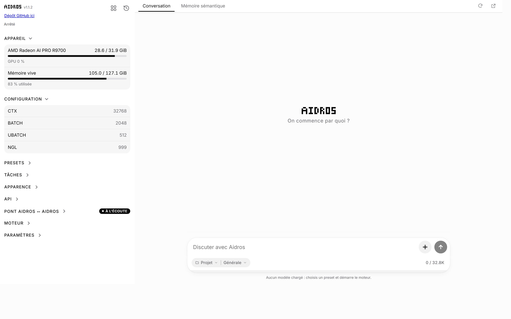

# Aidros

[**English**](README.md) · Français



> **Aidros suit sa propre ligne.** À la suite d'un changement de direction du
> projet originel, Aidros continue en produit à part entière, avec ses propres
> versions. Il descend de [**nathaninline/ajean**](https://github.com/nathaninline/ajean),
> créé et maintenu par **nathaninline**, dont il conserve et suit la base.
>
> Ce qu'Aidros y ajoute, et ce qu'est ce dépôt : un moteur **Mixture-of-Experts**
> ([**Strata**](https://github.com/Niko1221/Strata)) installé et piloté sur cartes
> **AMD et NVIDIA**, un **catalogue de modèles lu dans le moteur lui-même** plutôt
> que recopié à la main, une mémoire sémantique **EmbeddingGemma 2**, le **pont
> Aidros↔Aidros** (deux instances d'un même réseau local qui se parlent, chacune
> gardant son propre cerveau), le dédupliquage des appels d'outils, un seuil de
> compactage réglable, et un avertissement honnête quand le moteur sur le disque
> et celui que réclame un preset ne sont pas d'accord.
>
> Tout est décrit ci-dessous. Ce que ce dépôt change, exactement :
> [NOTICE.md](NOTICE.md).

**Faites tourner votre IA chez vous, et mettez les mains dedans.** Aidros tient
en un seul programme qui transforme un ordinateur doté d'une carte graphique (ou
d'un simple CPU) en assistant IA complet : interface de discussion, mémoire,
outils, accès web, tâches planifiées, accès depuis son téléphone — et rien qui
ne quitte votre machine.

Aidros est construit pour être **démonté**. Le moteur, le modèle, la taille de
contexte, le cache, les GPU, l'effort de réflexion, les réglages mémoire, les
outils, les tâches : tout est un réglage à portée de main, depuis l'interface ou
depuis la ligne de commande. C'est une boîte à outils à laquelle on se sert, pas
un produit qui fait un peu de tout sans laisser y toucher.

Le modèle lui-même tourne sur [llama.cpp](https://github.com/ggml-org/llama.cpp)
ou sur [Strata](https://github.com/Niko1221/Strata), et Aidros s'occupe de tout
le reste. Rien n'est envoyé chez quelqu'un d'autre : pas de compte, pas
d'abonnement, pas de quota.

---

## Sommaire

- [Installer](#installer)
- [Se servir d'Aidros](#se-servir-daidros)
- [Ce que l'IA peut faire](#ce-que-lia-peut-faire)
- [Moteurs et modèles](#moteurs-et-modèles)
- [Deux machines qui se connaissent](#deux-machines-qui-se-connaissent)
- [Accès depuis n'importe où](#accès-depuis-nimporte-où)
- [Vos données](#vos-données)
- [Référence](#référence)
- [Compiler depuis la source](#compiler-depuis-la-source)
- [Licence](#licence)

---

## Installer

Téléchargez le fichier de votre système depuis la
[dernière release](https://github.com/Cresius34/aidros/releases/latest) de ce
dépôt :

| Système | Fichier |
|---|---|
| Windows | `aidros-windows.exe` (`aidros-windows-arm.exe` pour ARM) |
| macOS | `aidros-macos-arm.zip` (Apple Silicon), `aidros-macos.zip` (Intel) — un vrai paquet `Aidros.app`, signé de façon ad hoc |
| Linux | `aidros-linux` (`aidros-linux-arm` pour ARM) — le binaire nu, sans archive |

Chaque release embarque un fichier `SHA256SUMS`, et Aidros vérifie ses propres
mises à jour contre ce fichier avant d'en installer une.

### Windows

Double-cliquez sur `aidros-windows.exe`. Aidros s'installe seul, pose ses
raccourcis et s'ouvre dans sa propre fenêtre, avec une icône dans la barre des
tâches ou la zone de notification. Rien d'autre à faire.

### macOS

Décompressez, glissez **Aidros.app** dans Applications, puis **clic droit →
Ouvrir** la première fois (l'app n'est signée que de façon ad hoc). Aidros
s'ouvre dans sa fenêtre et vit dans la barre de menus. Le moteur s'installe
tout seul ; ajoutez ensuite un modèle comme sous Windows. Pour la ligne de
commande, prenez le binaire nu `aidros-macos-arm` / `aidros-macos`.

### Linux (serveur)

```bash
curl -L -o aidros https://github.com/Cresius34/aidros/releases/latest/download/aidros-linux
chmod +x aidros && sudo mv aidros /usr/local/bin/aidros

sudo aidros install        # services, droits, dossiers
aidros edit                # indiquer MODEL=/chemin/vers/modele.gguf
aidros start               # démarre le modèle
aidros ui start            # interface sur http://<hote>:8090
```

Le moteur est téléchargé au premier démarrage, dans la variante qui va à la
machine : seul le pilote graphique est requis (pas de `git`, de `cmake` ni de
CUDA toolkit). `aidros engine` montre ce qui est installé ; pour imposer une
variante : `aidros engine repair --variant=vulkan` (ou `cuda`, `rocm`, `cpu`,
`auto`).

Sous Linux, Aidros tourne en **deux services** : `ajean-engine` fait tourner le
modèle, `ajean-ui` sert l'interface et l'endpoint OpenAI. Redémarrer l'interface
est instantané et ne recharge jamais le modèle.

### Mise à jour

```bash
aidros update
```

Ou le bouton de mise à jour dans l'interface. Aidros cherche les releases de
**ce dépôt** : il se met donc à jour depuis Aidros, pas depuis ailleurs.

---

## Se servir d'Aidros

### Deux modes de discussion

Choisissez le mode sur le bouton à gauche de la barre de saisie.

| Mode | Pour | Ce que l'IA a à portée de main |
|---|---|---|
| **Projet** | du travail qui s'étale sur plusieurs conversations | mémoire, traceurs, web, navigateur, MCP, tâches |
| **Jean** | un assistant personnel qui vous connaît | sa propre mémoire, des rappels, une seule conversation en cours |

Une conversation garde le mode dans lequel elle a commencé. Les outils dépendent
du **mode agent**, activé par défaut ; `aidros agent off` le coupe (le modèle
répond alors sans toucher à votre machine).

### Des onglets, sans nouvelle fenêtre du navigateur

La conversation et la mémoire sémantique vivent dans **deux onglets de la même fenêtre** :
pas de fenêtre de navigateur en plus, pas de seconde copie de l'interface qui mange la
mémoire vive pour elle. Un onglet ouvre la mémoire **sur place** ; les boutons sous la barre
la rechargent, ou la rendent à une vraie fenêtre de navigateur si c'est ce que vous
préférez. Les onglets apparaissent quand il y a quelque chose à montrer et disparaissent
quand il n'y a plus rien à montrer : la barre n'offre jamais une porte qui ne mène nulle part.

### Les projets

Un projet, c'est un dossier, une mémoire, un espace de travail et un jeu de
traceurs. Changer de projet bascule tout cela d'un coup. L'IA travaille dans un
espace de travail jetable et ne touche pas vos fichiers par accident.

### Jean, assistant personnel

Jean est un mode, pas un logiciel à part : la même interface, le même moteur, et
une mémoire qui parle de vous plutôt que d'une tâche. Il garde des rappels, et on
peut lui donner des règles qui survivent à chaque conversation.

### L'historique

Chaque conversation est conservée, consultable, et reprenable. Les conversations
longues sont résumées au fil de l'eau (voir
[Conversations longues](#ce-que-lia-peut-faire)), et le résumé garde ce qui
comptait, pas ce qui faisait le plus de bruit.

### Dans le terminal

Tout ce que fait l'interface, la ligne de commande le fait aussi :
`aidros chat`, `aidros engine status`, `aidros switch`, `aidros peer list`.
Utile en SSH, et utile dans un script.

---

## Ce que l'IA peut faire

Ces outils sont donnés au modèle tant que le mode agent est activé (c'est le cas
par défaut).

**Terminal et fichiers.** L'IA lance des commandes (bash, ou `cmd.exe` sous
Windows) et écrit ou modifie des fichiers. Elle travaille dans un **espace de
travail** jetable ; les scripts qui méritent de rester vont dans un dossier
**scripts** à part, qu'un ménage ne touche jamais.

**Mémoire, avec des embeddings.** La mémoire est tenue par projet, en pages, et
indexée par [EmbeddingGemma 2](https://huggingface.co/google/embeddinggemma-2) :
l'IA peut la chercher par le sens, pas seulement par mot-clé. Quatre réglages :
*injectée* (l'index est chargé d'avance), *recherche* (l'IA va chercher quand il
faut, plus léger en contexte), *à la demande* ( seulement quand vous le demandez),
ou *coupée*. Le moteur d'embeddings tourne sur votre machine, et un veilleur le
garde vivant.

**Traceurs.** Les données datées qui s'accumulent : compteurs, mesures, un
suivi qui court. L'IA les écrit, et vous les parcourez par niveau — une année,
un mois, un point — au lieu de relire une longue note.

**Web.** `web_search`, `web_open`, `web_read` et `web_grep`, avec le moteur
intégré : rien à installer. Il lit les pages servies en HTML, sans exécuter leur
JavaScript.

```bash
aidros internet on
```

**Contrôle du navigateur.** Avec `aidros computer on`, l'IA pilote un vrai
Chrome, Chromium ou Edge sur la machine : ouvrir une page, cliquer, taper,
faire défiler. Elle vise les éléments par l'arbre d'accessibilité, donc ça
marche même avec un petit modèle sans texte long. Vous voyez un aperçu en direct
pendant qu'elle navigue.

**Images en entrée.** Joignez une image à un message : un modèle multimodal la
voit et peut s'en servir. Les images sont redimensionnées avant d'être envoyées.

**Fichiers.** Envoyez des fichiers à l'IA depuis la discussion (jusqu'à 1 Go
chacun), et téléchargez en un clic ceux qu'elle crée.

**Serveurs MCP.** Branchez n'importe quel serveur
[Model Context Protocol](https://modelcontextprotocol.io) (fichiers, bases de
données, messagerie, API) depuis l'interface, en stdio ou en HTTP. Le format est
celui de Claude Desktop : une configuration existante se recopie telle quelle.
On peut activer et couper les serveurs et chaque outil séparément.

**Tâches planifiées.** L'IA travaille seule, à la fréquence que vous choisissez
(toutes les N minutes, heures ou jours, ou une expression cron) : surveiller une
boîte, résumer des nouvelles, suivre une valeur. Une tâche peut aussi être un
**script seul**, lancé sans charger le modèle du tout — pas de jetons, pas de
conversation. Chaque tâche choisit son projet, son preset, et si elle a droit à
la mémoire et au web. Un interrupteur général met tout en pause.

**Applications.** Aidros peut garder ses propres petites applications en un seul
fichier HTML/JS, servies sur leur propre port : un tableau de bord, un
formulaire, une visionneuse sur des données que l'IA a collectées. L'IA les
écrit, et elles tournent à côté de lui.

**Notifications.** Soyez prévenu quand une réponse est prête, même avec
l'application fermée ou le téléphone verrouillé. Sur iPhone, ajoutez d'abord
Aidros à l'écran d'accueil.

**Conversations longues.** Quand le contexte se remplit, les anciens tours sont
résumés automatiquement. `COMPACT_FRAC` en règle le seuil en pourcentage, par
machine. Les longs résultats d'outils sont archivés et l'IA peut les rappeller
quand il le faut : rien n'est vraiment perdu. Un tour résumé est transporté comme
**donnée, pas comme consigne** : un ordre lancé une fois en discutant ne revient
pas donner des ordres plus tard.

---

## Moteurs et modèles

### Les presets

Un preset est une configuration de modèle complète : fichier de modèle, taille
de contexte, couches sur GPU, cache KV, échantillonnage, effort de réflexion,
décodage spéculatif, vision. Changer de preset recharge le modèle, depuis
l'interface ou avec `aidros switch`. Les presets s'éditent dans l'interface ; les
fichiers de modèle peuvent vivre sur n'importe quel disque.

Un preset tourne de trois façons :

| Exécution | Ce que ça fait |
|---|---|
| **Local** | le moteur livré avec Aidros charge un `.gguf` sur vos GPU (on choisit lesquels par preset) |
| **API** | n'importe quel endpoint compatible OpenAI |
| **Service** | une commande de votre choix (vLLM, un autre `llama-server`, TabbyAPI, un script…) qui expose une API OpenAI sur la machine. Aidros la lance dans son service moteur, à la place du moteur (démarrer, arrêter, journaux, redémarrage en cas de panne), et utilise son API. |

**Télécharger un modèle.** Dans l'éditeur de preset, le champ « Télécharger un
modèle » cherche directement sur Hugging Face : tapez un nom (« qwen »,
« gemma »…), choisissez un dépôt puis une quantification, et Aidros le
télécharge. Un lien direct vers un `.gguf` fonctionne toujours.

### llama.cpp, à la manière d'Ollama

Aidros livre **une version précise de llama.cpp**, testée avec lui. Pas de moteur
à choisir, pas de mise à jour de moteur à lancer.

- **Installation automatique** : le `llama-server` officiel de cette version est
  téléchargé au premier lancement et vérifié contre l'empreinte SHA-256 consignée
  dans Aidros.
- **Variante choisie pour la machine** : **CUDA (NVIDIA)**, **ROCm (AMD)**,
  **Vulkan (AMD, Intel, et le reste)**, **Metal (Apple)** ou **CPU**. Chaque
  variante est essayée dans un process séparé ; si elle ne démarre pas ou ne voit
  pas de carte graphique, Aidros passe à la suivante, jusqu'au CPU. Les
  bibliothèques CUDA sont livrées avec le moteur : seul le pilote est nécessaire.
- **Mis à jour avec Aidros** : le moteur ne change que quand une mise à jour
  d'Aidros apporte une nouvelle version de llama.cpp ; il est alors remplacé au
  démarrage suivant.
- **En cas de panne** : la section **Moteur** affiche la version et la variante,
  et propose de le réparer (le retélécharger) ou d'imposer une variante.

### Strata MoE, le moteur qui connaît son propre catalogue

Sur une machine assez dotée, Aidros installe et pilote
[**Strata**](https://github.com/Niko1221/Strata), un moteur Mixture-of-Experts,
en un clic : sources et moteur précompilé, vérifiés par SHA-256.

- **AMD et NVIDIA.** Le moteur est installé pour la carte que vous avez. Sur AMD
  c'est le temps d'exécution HIP, avec une réserve de VRAM que vous fixez pour
  laisser de la place au bureau ; sur NVIDIA c'est CUDA.
- **Le catalogue vient du moteur.** L'écran Moteur énumère les familles et les
  tailles que le moteur installé connaît vraiment, avec leur coût mesuré, si
  elles tiennent sur cette machine, et **la raison** quand l'une d'elles est
  écartée. C'est lu dans le moteur, pas recopié à la main dans Aidros : ça ne
  peut pas devenir faux.
- **La version est par machine, et elle avertit au lieu de refuser.** Un preset
  nomme la version de moteur qu'il veut ; le moteur sur le disque déclare la
  sienne (dans son `BUILD.json`). Quand les deux diffèrent, le preset est marqué
  en rouge et dit pourquoi, **et démarre quand même** : une seule version d'Aidros
  peut servir plusieurs versions de moteur, donc changer de moteur sur une machine
  ne coûte plus une recompilation.
- **La vision, quand le modèle a été préparé pour ça.** `MOE_VISION` se choisit à
  la préparation du modèle, et l'interface le dit plutôt que d'échouer plus tard.

Les détails sont dans [docs/moteur.md](docs/moteur.md).

---

## Deux machines qui se connaissent

Le **pont Aidros↔Aidros** relie deux instances Aidros d'un même réseau local. Il
est **libre, local et décentralisé** : personne d'autre ne tient de serveur au
milieu, pas de compte, pas de relais, rien à payer, et pas de tiers qui pourrait
voir votre trafic. Chacun garde **son propre cerveau** — sa mémoire, son projet,
son modèle — donc une conversation entre deux Aidros est un canal entre deux
assistants, pas un assistant avec une mémoire empruntée.

Par le pont, une machine peut :

- **demander quelque chose à l'autre**, et obtenir une réponse de son propre
  modèle, avec ses propres outils et ses propres journaux ;
- **lire ses fichiers**, et lui **envoyer des fichiers** par le pont, dans les
  deux sens ;
- **la piloter** : choisir quel preset elle fait tourner, changer de preset,
  activer ou couper le mode agent — trois portes sur la carte Pont. Utile quand
  un modèle est planté sur une machine et qu'on est assis sur l'autre ;
- **prêter du travail** : un projet, une conversation, un modèle disponible d'un
  côté peuvent être prêtés à l'autre.

Deux choses à savoir, parce que c'est la partie honnête : changer de preset
**redémarre** cette instance, donc son pont s'éteint le temps du redémarrage ;
et le pont répond avec le **modèle local**, donc sur une machine dont le moteur
est arrêté, la partie conversation du pont est muette — le pilotage (presets,
mode, fichiers) répond toujours.

Le pont parle son propre petit protocole (des en-têtes `X-Aidros-*`) et accepte
les deux orthographes du nom d'en-tête, pour ne pas laisser un voisin plus ancien
dehors.

**La carte du Pont se met à la langue de l'interface.** Titre, badge d'état,
intitulés des réglages, messages d'erreur : tout passe par une clé, en français et en
anglais. Le nom du projet par défaut aussi — mais lui se traduit **sans bouger le nom
stocké**, qui est celui qui nomme le dossier mémoire : un projet rebaptisé « Mon
atelier » garde « Mon atelier » dans les deux langues. Changer de langue **ne recharge
pas** le fil de conversation : le libellé se recalcule depuis ce qui est déjà en
mémoire, pour qu'un changement de langue ne coûte pas plus cher qu'une ouverture de
tchat.

---

## Accès depuis n'importe où

**Sur votre réseau.** `aidros network on` rend l'interface et l'endpoint OpenAI
joignables sur le réseau local. Rien ne sort de votre réseau.

**Endpoint compatible OpenAI.** N'importe quel outil qui parle l'API OpenAI peut
utiliser votre modèle sur votre réseau : URL de base, votre clé API, terminé.
Scripts, IDE, autres clients de discussion, et l'autre Aidros du réseau.

L'accès distant par un relais (pour quand on est sorti et qu'on ne peut pas
ouvrir de port) ne fait plus partie d'Aidros : ce code est sorti du dépôt le
22 novembre 2026 et se relit dans la branche `link-relique`. Tout ce qui reste —
`aidros network on`, l'endpoint compatible OpenAI, le pont Aidros↔Aidros — reste
sur votre réseau.

---

## Vos données

Tout est sous **`$AJEAN_HOME`** : `/etc/aidros` sous Linux,
`%ProgramData%\Aidros` sous Windows (une installation plus ancienne sous `ajean`
est toujours trouvée et utilisée), `/etc/aidros` ou
`~/Library/Application Support/Aidros` sur macOS. `aidros where` donne les
chemins exacts.

| | |
|---|---|
| `ajean.db` | réglages, conversations, clés (une seule base [bbolt](https://github.com/etcd-io/bbolt)) |
| `presets/` | un fichier `.env` par preset |
| `memory/` | les pages de mémoire, un dossier par projet |
| `models/` | les fichiers de modèle |
| `backends/` | le moteur (`backends/engine/`) |
| `logs/` | les journaux du moteur, un par moteur |
| `workspace/` | l'espace de travail jetable de l'IA |
| `scripts/` | les scripts que l'IA garde |

**Le chiffrement au repos** (facultatif, un interrupteur dans les réglages)
chiffre la mémoire et les conversations en AES-256. La clé, c'est votre clé
d'accès à l'interface : elle ne vit que dans vos navigateurs, le serveur n'en
garde que l'empreinte. Une **clé de récupération** est donnée quand on l'active.
Un instantané est pris avant chaque bascule : on ne peut rien perdre.

Pas de télémétrie. Aidros ne fait aucune requête qui rapporte quoi que ce soit
sur vous ; les seuls appels qu'il fait de lui-même sont pour chercher une
nouvelle release, et pour télécharger un modèle que vous avez demandé.

---

## Référence

### Commandes

Ce que `aidros help` affiche, en entier. Les deux services sont `ajean-engine`
(le modèle) et `ajean-ui` (l'interface, l'endpoint OpenAI).

```
Moteur (ajean-engine)
  start | stop | restart        gérer le service
  status | logs                 état / journaux en direct
  enable | disable              démarrage au boot
  edit                          éditer la configuration dans $EDITOR
  switch [N]                    changer de preset
  test | bench [N]              vérifier que le modèle répond / mesurer tok/s
  vram                          usage GPU et VRAM
  gpu [index…]                  lister les GPU / choisir lesquels (gpu all = tous)
  set-api-key [clé]             protéger le moteur par une clé Bearer
  network [on|off|status]       rendre l'endpoint OpenAI joignable du réseau local

Interface (ajean-ui)
  ui [start|stop|restart|status]  piloter le service d'interface
  web [PORT]                      servir l'interface au premier plan (:8090)
  set-web-key [clé]               protéger l'API de pilotage

Les outils de l'IA
  chat [consigne]                 discussion en terminal, en flux
  export [options] [fichier]      exporter la conversation de l'interface
  agent [on|off|status]           donner à l'IA ses outils (shell, fichiers, mémoire)
  computer [on|off|status]        laisser l'IA piloter un Chrome local
  internet [on|off|status]        laisser l'IA utiliser le web
  memory [off|ondemand|always|search|status]   le mode mémoire de l'IA

Le pont Aidros↔Aidros
  bridge [status|on|off|serve]  le côté de cette machine
  peer [list|add|rm|ask|files|send|get|drop]   les autres machines

Le moteur livré avec Aidros (une version précise, testée, installée seule)
  engine                        version, variante (CUDA/ROCm/Vulkan/Metal/CPU)
  engine install                l'installer tout de suite (sinon : au premier démarrage)
  engine repair [--variant=auto|cuda|rocm|vulkan|cpu]

La machine
  where                         tous les chemins qu'utilise Aidros
  install | uninstall
  update [--check]              vérifier et installer une mise à jour
  version                       la version qu'on fait tourner
```

### Clés de configuration

À poser avec `aidros edit`, ou dans les réglages. Les clés qui comptent le plus :
`MODEL`, `BIN`, `CTX`, `NGL`, `KV`, `PORT`, `HOST`, `REASONING_EFFORT`,
`COMPACT`, `COMPACT_MAX`, `COMPACT_FRAC`, `MEM_MODE`, `MEM_ENCRYPTED`,
`MACHINES`, `CUDA_VISIBLE_DEVICES`. Un preset MoE ajoute
`ENGINE=moe`, `MOE_RUNTIME`, `MOE_MODEL`, `MOE_BACKEND`, `MOE_KV`, `MOE_SPEC`,
`MOE_VISION`, `MOE_VRAM_RESERVE`, `MOE_HELPER`.

Certaines clés sont **par machine** et survivent à un changement de preset
(`MEM_MODE`, `HOST`, `MEM_ENCRYPTED`, `COMPACT`, `COMPACT_MAX`,
`COMPACT_FRAC`, `MACHINES`, `CUDA_VISIBLE_DEVICES`) — la liste est
`preservedKeys` dans `backend_presets.go`. Un preset qui en nomme une
explicitement gagne quand même : `CUDA_VISIBLE_DEVICES` et `HOST` ne sont gardés
que si le preset qui arrive ne les nomme pas.

### Variables d'environnement

`AJEAN_HOME` déplace tout le dossier de données. `AJEAN_SERVICE` nomme le service
moteur — c'est ainsi qu'une machine fait tourner un service qui n'est pas
llama.cpp.

### API de pilotage

L'interface est une petite API HTTP avec les mêmes clés que les boutons
(`/api/status`, `/api/presets`, `/api/peers`, `/api/tasks`, `/api/update`…),
protégée par votre clé API. Tout ce qu'on peut cliquer, un script peut l'appeler.

---

## Compiler depuis la source

Il faut [Go](https://go.dev) 1.25 ou plus récent. Rien d'autre : l'interface est
livrée en fichiers dans le dépôt, et le moteur se télécharge à l'exécution.

```bash
git clone https://github.com/Cresius34/aidros && cd aidros
go generate ./internal/aidros   # assemble l'interface
go build -o aidros ./cmd/aidros
```

- `cmd/aidros/` : le point d'entrée, l'icône et les infos Windows du binaire.
- `internal/aidros/` : tout le code.
- `internal/aidros/ui/` : l'interface (`src/` est la source, `index.html` est
  généré — ne pas l'éditer à la main).
- `tools/` : l'assembleur, les installeurs, les aides de test.

`go generate` puis `go test ./...` est ce que joue la CI, avec `gofmt`,
`go vet` et `staticcheck`.

---

## Licence

MIT, comme AJEAN en amont. Voir [LICENSE](LICENSE).

Ce bifurcateur est entretenu pour un petit nombre de machines et **n'est pas**
une version officielle d'AJEAN : notre ligne de correctifs est testée sur le
matériel où nous la faisons tourner, et nous le disons franchement plutôt que de
promettre que ça marche partout. Le projet amont reste l'origine de la base, et
c'est à son auteur qu'on le doit.
