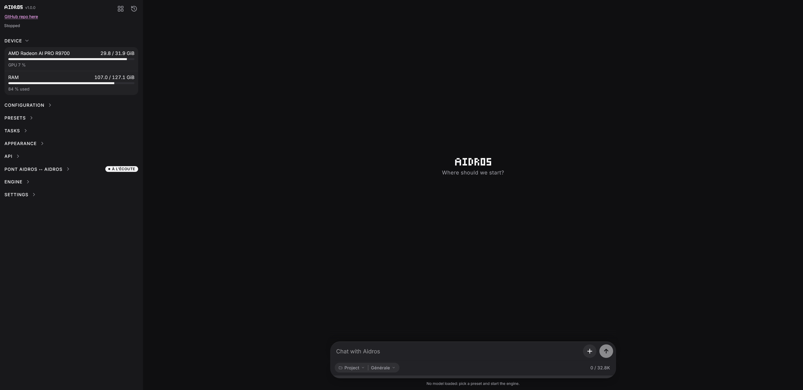

# Aidros

**English** · [Français](README.fr.md)



> **Aidros runs its own line.** Following a change of direction in the original
> project, Aidros carries on as its own product, with its own releases. It
> descends from [**nathaninline/ajean**](https://github.com/nathaninline/ajean),
> created and maintained by **nathaninline**, whose base it keeps and follows.
>
> What Aidros adds, and what this repository is for: a **Mixture-of-Experts
> engine** ([**Strata**](https://github.com/Niko1221/Strata)) installed and
> driven on **AMD and NVIDIA** cards, a model **catalogue read from the engine
> itself** rather than copied by hand, **EmbeddingGemma 2** semantic memory, the
> **Aidros↔Aidros bridge** (two instances on one local network talking to each
> other, each keeping its own brain), tool-call de-duplication, a tunable
> compaction threshold, and an honest warning when the engine on disk and the
> one a preset asks for disagree.
>
> Everything is described below. What exactly this repository changes:
> [NOTICE.md](NOTICE.md).

**Run your own AI at home, and tinker inside it.** Aidros is a single program
that turns a computer with a graphics card (or a plain CPU) into a complete AI
assistant: a chat interface, memory, tools, web access, scheduled tasks, and
access from your phone — with nothing leaving your machine.

Aidros is built to be **taken apart**. The engine, the model, the context size,
the cache, the GPUs, the reasoning effort, the memory settings, the tools, the
tasks: everything is a setting you can reach, from the interface or from a
command. It is meant to be a capable toolbox you can reach into, not a product
that does a bit of everything and lets you touch none of it.

The model itself runs on [llama.cpp](https://github.com/ggml-org/llama.cpp) or
on [Strata](https://github.com/Niko1221/Strata), and Aidros handles
everything around it. Nothing is sent to anyone else's servers: no account, no
subscription, no quota.

---

## Contents

- [Install](#install)
- [Using Aidros](#using-aidros)
- [What the AI can do](#what-the-ai-can-do)
- [Engines and models](#engines-and-models)
- [Two machines that know each other](#two-machines-that-know-each-other)
- [Access from anywhere](#access-from-anywhere)
- [Your data](#your-data)
- [Reference](#reference)
- [Build from source](#build-from-source)
- [License](#license)

---

## Install

Download the file for your system from the
[latest release](https://github.com/Cresius34/aidros/releases/latest) of this
repository:

| System | File |
|---|---|
| Windows | `aidros-windows.exe` (`aidros-windows-arm.exe` for ARM) |
| macOS | `aidros-macos-arm.zip` (Apple Silicon), `aidros-macos.zip` (Intel) — a real `Aidros.app` bundle, ad-hoc signed |
| Linux | `aidros-linux` (`aidros-linux-arm` for ARM) — the bare binary, no archive |

Every release ships a `SHA256SUMS` file, and Aidros verifies its own updates
against it before installing one.

### Windows

Double-click `aidros-windows.exe`. Aidros installs itself, adds its shortcuts,
and opens in its own window, with an icon in the menu bar or the system tray.
Nothing else to do.

### macOS

Unzip, drag **Aidros.app** into Applications, then **right-click and Open** the
first time (the app is only ad-hoc signed). Aidros opens in its own window and
lives in the menu bar. The engine installs itself; then add a model as on
Windows. For command-line use, take the bare binary `aidros-macos-arm` /
`aidros-macos` instead of the app.

### Linux (server)

```bash
curl -L -o aidros https://github.com/Cresius34/aidros/releases/latest/download/aidros-linux
chmod +x aidros && sudo mv aidros /usr/local/bin/aidros

sudo aidros install        # services, permissions, folders
aidros edit                # set MODEL=/path/to/model.gguf
aidros start               # starts the model
aidros ui start            # interface at http://<host>:8090
```

The engine is downloaded on first start, in the variant that fits the machine:
only the graphics driver is required (no `git`, `cmake` or CUDA toolkit).
`aidros engine` shows what is installed; to force a variant:
`aidros engine repair --variant=vulkan` (or `cuda`, `rocm`, `cpu`, `auto`).

On Linux, Aidros runs as **two services**: `ajean-engine` runs the model,
`ajean-ui` serves the interface and the OpenAI endpoint. Restarting the
interface is instant and never reloads the model.

### Updating

```bash
aidros update
```

Or the update button in the interface. Aidros looks for releases of **this
repository**, so it updates from Aidros, not from anywhere else.

---

## Using Aidros

### Two chat modes

Pick a mode from the button on the left of the input bar.

| Mode | For | What the AI has |
|---|---|---|
| **Project** | real work that spans several conversations | memory, trackers, web, browser, MCP, tasks |
| **Jean** | a personal assistant that knows you | its own memory, reminders, a single ongoing conversation |

A conversation keeps the mode it started in. Tools rely on **agent mode**, which
is on by default; `aidros agent off` turns it off (the model then answers without
touching your machine).

### Projects

A project is a folder, a body of memory, a workspace and a set of trackers.
Switching project switches all of it at once. The AI works in a disposable
workspace and never touches your files by accident.

### Jean, personal assistant

Jean is a mode, not a separate program: the same interface, the same engine, and
a memory that is about you rather than about a task. It keeps reminders, and it
can be given rules that survive every conversation.

### History

Every conversation is kept, searchable, and can be resumed. Long conversations
are summarized as they go (see [Long conversations](#what-the-ai-can-do)), and
the summary keeps the things that mattered rather than the things that were
loudest.

### In the terminal

Everything the interface does, the command line does too: `aidros chat`,
`aidros engine status`, `aidros switch`, `aidros peer list`. Useful over SSH, and
useful in a script.

---

## What the AI can do

These tools are given to the model as long as agent mode is on (it is by
default).

**Terminal and files.** The AI runs commands (bash, or `cmd.exe` on Windows) and
writes or edits files. It works in a disposable **workspace**; scripts worth
keeping go into a separate **scripts** folder that a cleanup never touches.

**Memory, with embeddings.** Memory is kept per project, as pages, and is
indexed by [EmbeddingGemma 2](https://huggingface.co/google/embeddinggemma-2)
so the AI can search it by meaning and not only by keyword. Four settings:
*injected* (the index is loaded up front), *search* (the AI looks things up when
needed, lighter on context), *on demand* (only when you ask), or *off*. The
embedding engine runs on your machine, and a watchdog keeps it alive.

**Trackers.** Dated data that piles up: counters, readings, a running follow-up.
The AI writes them, and you browse them by level — a year, a month, one point —
instead of reading one long note.

**Web.** `web_search`, `web_open`, `web_read` and `web_grep`, with the built-in
engine: nothing to install. It reads pages served as HTML, without running their
JavaScript.

```bash
aidros internet on
```

**Browser control.** With `aidros computer on`, the AI drives a real Chrome,
Chromium or Edge on the machine: open a page, click, type, scroll. It targets
elements through the accessibility tree, so it works even with small text-only
models. You see a live preview while it browses.

**Images in.** Attach an image to a message, and a multimodal model sees it and
can use it. Images are resized before being sent.

**Files.** Send files to the AI from the chat (up to 1 GB each), and download
the files it creates with a click.

**MCP servers.** Plug in any [Model Context Protocol](https://modelcontextprotocol.io)
server (files, databases, mail, APIs) from the interface, over stdio or HTTP. The
format is the one used by Claude Desktop, so an existing configuration copies
over as is. Servers and individual tools can be switched on and off.

**Scheduled tasks.** The AI works on its own, at the frequency you choose (every
N minutes, hours or days, or a cron expression): check a mailbox, summarize
news, follow a figure. A task can also be a **script only**, run without loading
the model at all — no tokens, no conversation. Each task chooses its project,
its preset, and whether it may use memory and the web. A master switch pauses
everything.

**Applications.** Aidros can keep small one-file HTML/JS apps of its own, served
on its own port: a dashboard, a form, a viewer over data the AI has collected.
The AI writes them, and they run beside it.

**Notifications.** Get notified when a reply is ready, even with the app closed
or the phone locked. On iPhone, add Aidros to the home screen first.

**Long conversations.** When the context fills up, older turns are summarized
automatically. `COMPACT_FRAC` sets the threshold as a percentage, per machine.
Long tool results are archived and can be recalled by the AI when needed, so
nothing is truly lost. A summarized turn is carried as **data, not as
instruction**: a one-off order given while chatting does not come back to boss
the AI around later.

---

## Engines and models

### Presets

A preset is a complete model configuration: model file, context size, GPU
layers, KV cache, sampling, reasoning effort, speculative decoding, vision.
Switching preset reloads the model, from the interface or with `aidros switch`.
Presets are edited in the interface; model files can live on any disk.

A preset runs in one of three ways:

| Execution | What it does |
|---|---|
| **Local** | the engine shipped with Aidros loads a `.gguf` on your GPUs (choose which ones per preset) |
| **API** | any OpenAI-compatible endpoint |
| **Service** | a command of your choice (vLLM, another `llama-server`, TabbyAPI, a script…) that exposes an OpenAI API on this machine. Aidros runs it in its engine service, in place of the engine (start, stop, log, restart on failure), and uses its API. |

**Downloading a model.** In the preset editor, the "Download a model" field
searches Hugging Face directly: type a name ("qwen", "gemma"…), pick a
repository then a quantization, and Aidros downloads it. A direct link to a
`.gguf` still works.

### llama.cpp, the way Ollama does it

Aidros ships **one specific llama.cpp version**, tested with it. There is no
engine to choose and no engine update to run.

- **Automatic install**: the official `llama-server` of that version is
  downloaded on first launch and verified against the SHA-256 digest recorded in Aidros.
- **Variant picked for the machine**: **CUDA (NVIDIA)**, **ROCm (AMD)**,
  **Vulkan (AMD, Intel, and anything else)**, **Metal (Apple)** or **CPU**. Each
  variant is tried in a separate process; if it does not start or sees no
  graphics card, Aidros moves to the next one, down to CPU. The CUDA libraries
  ship with the engine: only the driver is required.
- **Updated with Aidros**: the engine only changes when an Aidros update brings
  a new llama.cpp version; it is then replaced at the next start.
- **Troubleshooting**: the **Engine** section shows the version and variant, and
  offers to repair it (download it again) or to force a variant.

### Strata MoE, the engine that knows its own catalogue

On a machine with enough memory, Aidros can install and drive
[**Strata**](https://github.com/Niko1221/Strata), a Mixture-of-Experts engine,
in one click: sources and prebuilt engine, verified by SHA-256.

- **AMD and NVIDIA.** The engine is installed for the card you have. On AMD the
  HIP runtime is used, with a VRAM reserve you set so the engine leaves room for
  the desktop; on NVIDIA it is CUDA.
- **The catalogue comes from the engine.** The Engine screen lists the families
  and sizes the installed engine really knows, with their measured cost, whether
  they fit this machine, and **the reason** when one of them is ruled out. It is
  read from the engine, not copied by hand into Aidros, so it cannot go stale.
- **The version is per machine, and it warns instead of refusing.** A preset
  names the engine version it wants; the engine on disk declares the one it is
  (in its `BUILD.json`). When the two disagree, the preset is marked in red and
  says why, **and still starts**: one Aidros build can serve several engine
  versions, so changing the engine on a machine no longer costs a rebuild.
- **Vision, when the model was prepared for it.** `MOE_VISION` is chosen when
  the model is prepared, and the interface says so rather than failing later.

See [docs/moteur.md](docs/moteur.md) (in French) for the details.

---

## Two machines that know each other

The **Aidros↔Aidros bridge** connects two Aidros instances on one local network.
It is **free, local and decentralised**: there is no server of anyone else's in
the middle, no account, no relay, nothing to pay for, and no third party who
could see your traffic. Each side keeps **its own brain** — its own memory, its
own project, its own model — so a conversation between two Aidros is a channel
between two assistants, not one assistant with a borrowed memory.

Over the bridge, one machine can:

- **ask the other something**, and get an answer from its own model, with its
  own tools and its own logs;
- **read its files**, and **send files to it** through the bridge, in either
  direction;
- **drive it**: pick which preset it runs, switch preset, turn agent mode on or
  off — three doors on the bridge card. Useful when a model is stuck on one
  machine and you are sitting at the other;
- **hand over work**: a project, a conversation, a model available on one side
  can be lent to the other.

Two things worth knowing, because they are the honest parts: switching a preset
**restarts** that instance, so its bridge goes down for the length of the
restart; and the bridge answers with the **local model**, so on a machine whose
engine is stopped, the conversation part of the bridge is silent — control
(presets, mode, files) keeps answering.

The bridge speaks its own small protocol (`X-Aidros-*` headers) and accepts both
spellings of the header name, so an older neighbour is not left out.

---

## Access from anywhere

**On your own network.** `aidros network on` makes the interface and the OpenAI
endpoint reachable on the LAN. Nothing leaves your network.

**OpenAI-compatible endpoint.** Any tool that speaks the OpenAI API can use your
model over your network: base URL, your API key, done. Scripts, IDEs, other chat
clients, and the other Aidros on the network.

Remote access through a relay (for when you are out and cannot open a port) is
no longer part of Aidros: that code left the repository on 22 November 2026 and
can be read again in the `link-relique` branch. Everything else here —
`aidros network on`, the OpenAI-compatible endpoint, the Aidros↔Aidros bridge —
stays on your network.

---

## Your data

Everything lives under **`$AJEAN_HOME`**: `/etc/aidros` on Linux,
`%ProgramData%\Aidros` on Windows (an older install under `ajean` is still
found and used), `/etc/aidros` or `~/Library/Application Support/Aidros` on
macOS. `aidros where` shows the exact paths.

| | |
|---|---|
| `ajean.db` | settings, conversations, keys (a single [bbolt](https://github.com/etcd-io/bbolt) database) |
| `presets/` | one `.env` file per preset |
| `memory/` | memory pages, one folder per project |
| `models/` | model files |
| `backends/` | the engine (`backends/engine/`) |
| `logs/` | engine logs, one per backend |
| `workspace/` | the AI's disposable working folder |
| `scripts/` | the scripts the AI keeps |

**Encryption at rest** (optional, one switch in the settings) encrypts memory
and conversations with AES-256. The key is your access key to the interface: it
lives only in your browsers, the server keeps just its fingerprint. A **recovery
key** is given when you turn it on. A snapshot is taken before every switch, so
nothing can be lost.

No telemetry. Aidros makes no request that reports anything about you; the only
calls it makes on its own are to check for a new release, and to download a
model you asked for.

---

## Reference

### Commands

What `aidros help` prints, in full. The two services are `ajean-engine` (the
model) and `ajean-ui` (the interface, the OpenAI endpoint).

```
Engine (ajean-engine)
  start | stop | restart        manage the service
  status | logs                 state / live logs
  enable | disable              start on boot
  edit                          edit the configuration in $EDITOR
  switch [N]                    change preset
  test | bench [N]              check the model answers / measure tok/s
  vram                          GPU and VRAM usage
  gpu [index...]                list GPUs / choose which to use (gpu all = all)
  set-api-key [key]             protect the engine with a Bearer key
  network [on|off|status]       expose the OpenAI endpoint on the LAN

Interface (ajean-ui)
  ui [start|stop|restart|status]  drive the interface service
  web [PORT]                      serve the interface in the foreground (:8090)
  set-web-key [key]               protect the control API

The AI's tools
  chat [system-prompt]          streamed chat in the terminal
  export [options] [file]       export the interface's conversation
  agent [on|off|status]         give the AI its tools (shell, files, memory)
  computer [on|off|status]      let the AI drive a local Chrome
  internet [on|off|status]      let the AI use the web
  memory [off|ondemand|always|search|status]   the AI's memory mode

The Aidros↔Aidros bridge
  bridge [status|on|off|serve]  this machine's side of the bridge
  peer [list|add|rm|ask|files|send|get|drop]   the other machines

Engine shipped with Aidros (one tested version, installed on its own)
  engine                        version, variant (CUDA/ROCm/Vulkan/Metal/CPU)
  engine install                install it now (else: on first start)
  engine repair [--variant=auto|cuda|rocm|vulkan|cpu]

Machine
  where                         every path Aidros uses
  install | uninstall
  update [--check]              check and install an update
  version                       the version you are running
```

### Configuration keys

Set with `aidros edit`, or in the settings. The keys that matter most: `MODEL`,
`BIN`, `CTX`, `NGL`, `KV`, `PORT`, `HOST`, `REASONING_EFFORT`, `COMPACT`,
`COMPACT_MAX`, `COMPACT_FRAC`, `MEM_MODE`, `MEM_ENCRYPTED`,
`MACHINES`, `CUDA_VISIBLE_DEVICES`. A MoE preset adds `ENGINE=moe`,
`MOE_RUNTIME`, `MOE_MODEL`, `MOE_BACKEND`, `MOE_KV`, `MOE_SPEC`, `MOE_VISION`,
`MOE_VRAM_RESERVE`, `MOE_HELPER`.

Some keys are **per machine** and survive a preset switch (`MEM_MODE`, `HOST`,
`MEM_ENCRYPTED`, `COMPACT`, `COMPACT_MAX`, `COMPACT_FRAC`,
`MACHINES`, `CUDA_VISIBLE_DEVICES`) — the list is `preservedKeys` in
`backend_presets.go`. A preset that explicitly sets one of them still wins:
`CUDA_VISIBLE_DEVICES` and `HOST` are only kept if the incoming preset does not
name them.

### Environment variables

`AJEAN_HOME` moves the whole data folder. `AJEAN_SERVICE` names the engine
service, which is how a machine runs a service that is not llama.cpp.

### Control API

The interface is a small HTTP API with the same keys as the buttons
(`/api/status`, `/api/presets`, `/api/peers`, `/api/tasks`, `/api/update`…),
authenticated with your API key. Anything you can click, a script can call.

---

## Build from source

You need [Go](https://go.dev) 1.25 or newer. Nothing else: the interface ships
as files in the repository, and the engine is downloaded at run time.

```bash
git clone https://github.com/Cresius34/aidros && cd aidros
go generate ./internal/aidros   # assembles the interface
go build -o aidros ./cmd/aidros
```

- `cmd/aidros/` : the entry point, the icon and the Windows version info.
- `internal/aidros/` : all the code.
- `internal/aidros/ui/` : the interface (`src/` is the source, `index.html` is
  generated — do not edit it by hand).
- `tools/` : the assembler, the installers, the test helpers.

`go generate` then `go test ./...` is what CI runs, along with `gofmt`,
`go vet` and `staticcheck`.

---

## License

MIT, as upstream AJEAN. See [LICENSE](LICENSE).

This fork is maintained for a small number of machines and is **not** an
official release of AJEAN: our patch line is tested on the hardware we run it
on, and we say so plainly rather than promising it works everywhere. The
upstream project remains the origin of the base, and its author is who to thank
for it.
